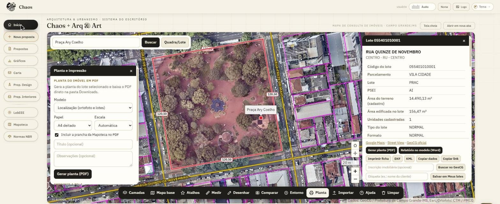
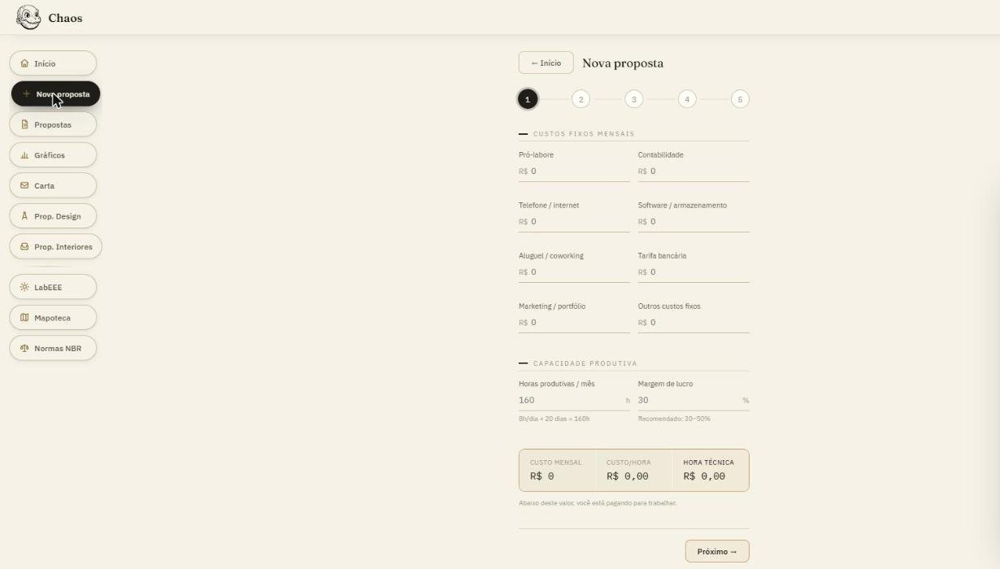
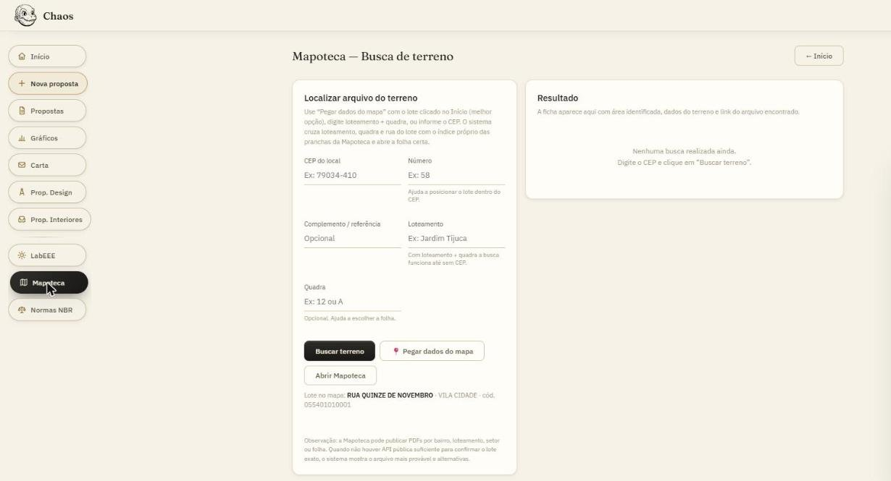
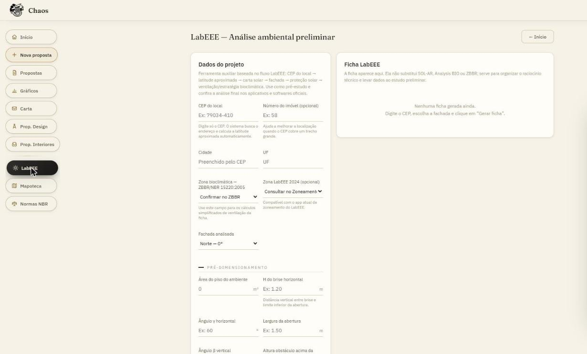
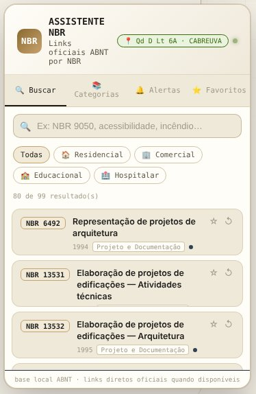

# Chaos + Arq & Art

Sistema interno do escritório **Referência Soluções Arquitetônicas e Ambientais** (Arqta Samária Rosa), Campo Grande/MS.
Reúne o mapa de consulta de imóveis de Campo Grande, as propostas comerciais e as ferramentas técnicas do dia a dia: Mapoteca, LabEEE e Normas NBR.

**[→ Abrir o sistema](https://arguiteto.github.io/ser-honorarios/)** · **[→ Abrir só o mapa](https://arguiteto.github.io/ser-honorarios/mapa.html)**



---

## O que tem no menu

| Menu | Para que serve |
|------|----------------|
| **Início** | Mapa de consulta de imóveis de Campo Grande, com dados do GeoCG/PMCG |
| **Nova proposta** | Calcula honorários em 5 etapas: escritório → fases → impostos → desconto → proposta |
| **Propostas** | Propostas salvas, para abrir, editar e exportar |
| **Gráficos** | Totais, ticket médio e distribuição das propostas |
| **Carta** | Carta ou documento simples no timbrado, em PDF |
| **Prop. Design** / **Prop. Interiores** | Propostas específicas de design e de interiores |
| **LabEEE** | Análise ambiental preliminar: carta solar, ZB, brises e ventilação |
| **Mapoteca** | Localiza a prancha oficial do loteamento do terreno |
| **Normas NBR** | Assistente de NBRs com link oficial ABNT, favoritos e alertas de atualização |

No topo ficam **Áudio** (player), **Nome** (perfil de quem está usando), **Logo** (identidade visual dos PDFs) e **Tema** (claro/escuro).

---

## Como usar

### 1. Consultar um imóvel no mapa (Início)

1. Na barra de busca, digite o **código do lote, a inscrição, o endereço, o nome do lugar ou uma coordenada**. O botão **Quadra/Lote** busca por parcelamento + quadra + lote.
2. Clique no lote no mapa. A **ficha do lote** abre à direita com endereço, parcelamento, quadra, lote, PSEI, área do terreno, área edificada, unidades, topografia e outros dados.
3. Na ficha estão os botões:
   - **Gerar planta (PDF)**: planta de localização pronta para o processo.
   - **Relatório no modelo (Word)**: relatório de conformidade do lote, com dados do GeoCG e do SISGRAN.
   - **Imprimir ficha · DXF · KML · Copiar dados · Copiar link**.
   - **Salvar em Meus lotes**: guarda o lote com uma etiqueta, por exemplo o nome do cliente.
4. A barra de ferramentas embaixo do mapa tem **Camadas · Mapa base · Atalhos · Medir · Desenhar · Comparar · Entorno · Planta · Importar · Ajuda · Limpar**.

> O sistema guarda o último lote clicado. **Mapoteca**, **LabEEE** e o **Assistente NBR** usam esse lote sem precisar digitar os dados de novo.

#### Planta em PDF + prancha da Mapoteca

No painel **Planta**, escolha modelo, papel e escala e clique **Gerar planta (PDF)**. Com a opção **"Incluir a prancha da Mapoteca no PDF"** marcada, o sistema anexa ao final do arquivo a prancha oficial do loteamento, buscada no índice próprio (`mapoteca-indice.json`). O aviso que aparece depois diz o que aconteceu:

| Aviso | O que significa |
|-------|-----------------|
| *com a prancha da Mapoteca (LOTEAMENTO, folha 03)* | A prancha foi encontrada e anexada |
| *…confira qual é a do lote* | O loteamento tem várias folhas e a quadra não bastou para escolher uma. Confira a folha anexada |
| *o parcelamento "X" é desdobro, com quadra e lote próprios* | O lote vem de **desdobro, desmembramento, remembramento ou área da rede ferroviária**. A numeração dele não segue a do loteamento do bairro, e a Mapoteca não publica essa planta. Use a planta do desdobro aprovado ou a matrícula |
| *o parcelamento "X" não tem planta publicada* | A prefeitura não publicou prancha desse parcelamento no portal |
| *não consegui carregar o índice agora* | Houve falha de conexão. Tente de novo |
| *não consegui baixar a prancha agora* | A prancha foi encontrada, mas o site da prefeitura não respondeu. Abra pelo link do aviso |

### 2. Montar uma proposta (Nova proposta)



1. **① Escritório**: custos fixos mensais, horas produtivas e margem de lucro definem a **hora técnica**.
2. **② Fases**: horas por fase do projeto (NBR 13531/13532) e visitas técnicas.
3. **③ Impostos**: ISS, IRPJ+CSLL, PIS+COFINS, RRT e outros, todos editáveis.
4. **④ Desconto**: percentual ou valor fixo, mais as condições de parcelamento.
5. **⑤ Proposta**: resumo final, com exportação em PDF, cópia para WhatsApp e opção de salvar em **Propostas**.

### 3. Achar a prancha do terreno (Mapoteca)



- O caminho mais rápido é clicar o lote no mapa do Início, voltar para cá e usar **📍 Pegar dados do mapa**.
- Também dá para informar o **CEP** ou **loteamento + quadra** e clicar **Buscar terreno**.
- Quando a folha estiver certa, marque **"É esta a prancha"**. O sistema registra a confirmação e, da próxima vez, abre direto a folha certa.

### 4. Análise ambiental preliminar (LabEEE)



Informe o CEP (ou use **Pegar dados do mapa**), escolha a fachada e clique **Gerar ficha**. A ficha traz carta solar, estratégia bioclimática (ZBBR/NBR 15220), zoneamento LabEEE 2024, proteção solar/brises e máscara de obstrução. É um pré-estudo: a análise final continua nos softwares oficiais (SOL-AR, Analysis BIO, ZBBR).

### 5. Assistente NBR



Fica no botão **NBR**, no canto inferior direito.

- **Lote do mapa automático:** quando você clica num terreno no mapa, o assistente assume aquele lote como local da obra (Campo Grande/MS, ZB 6). O selo 📍 no topo mostra quadra, lote e bairro, e não é preciso digitar CEP.
- Se nenhum lote foi clicado, ele pede o CEP da obra, ou você pode clicar em **Pular**.
- Tem as abas **Buscar · Categorias · Alertas · Favoritos**, filtro por uso (residencial, comercial, educacional, hospitalar) e o link oficial ABNT de cada norma.

<br clear="right">

---

## Arquivos do repositório

| Arquivo | O que é |
|---------|---------|
| `index.html` | Sistema completo: menu, propostas, ferramentas e assistente NBR |
| `mapa.html` | Mapa de consulta. Abre sozinho ou embutido no Início |
| `mapoteca-indice.json` | Índice próprio das pranchas da Mapoteca: loteamento → folhas, ruas e quadras |
| `mapoteca-confirmadas.json` | Folhas confirmadas com "É esta a prancha" |
| `gerar_indice_mapoteca.py` | Script que gera o índice a partir do portal da prefeitura (`pip install pypdf`) |
| `ponte-sisgran.gs` | Ponte em Google Apps Script, na conta do escritório. Baixa os PDFs da prefeitura e os dados do SISGRAN, que o navegador não consegue acessar direto |
| `manifest.webmanifest`, ícones | Arquivos para instalar como app no celular ou no computador |
| `prints/` | Imagens deste README |

### Atualizar o índice da Mapoteca

```bash
pip install pypdf
python gerar_indice_mapoteca.py            # coleta completa: lista as pranchas e lê ruas/quadras de cada PDF
python gerar_indice_mapoteca.py --sem-pdf  # só a lista, mais rápido
```

Depois, suba o `mapoteca-indice.json` novo para o GitHub. Desdobros, desmembramentos e áreas da rede ferroviária não entram no índice porque a prefeitura não publica prancha deles.

---

## Fontes de dados

- **GeoCG / Prefeitura de Campo Grande-MS**: lotes, imóveis, parcelamentos e ortofoto (CTM/PMCG)
- **Mapoteca SEMADES/SEMADUR**: pranchas de loteamento (mídias públicas do portal)
- **SISGRAN**: dados urbanísticos do lote, via ponte Apps Script
- **ViaCEP**: localização por CEP
- **ABNT**: links oficiais das normas
- **NBR 13531/13532** e **tabela CAU/BR**: referência para fases e honorários

---

Uso interno do escritório. Os dados são públicos, da Prefeitura de Campo Grande. Confira sempre as informações oficiais antes de protocolar.
